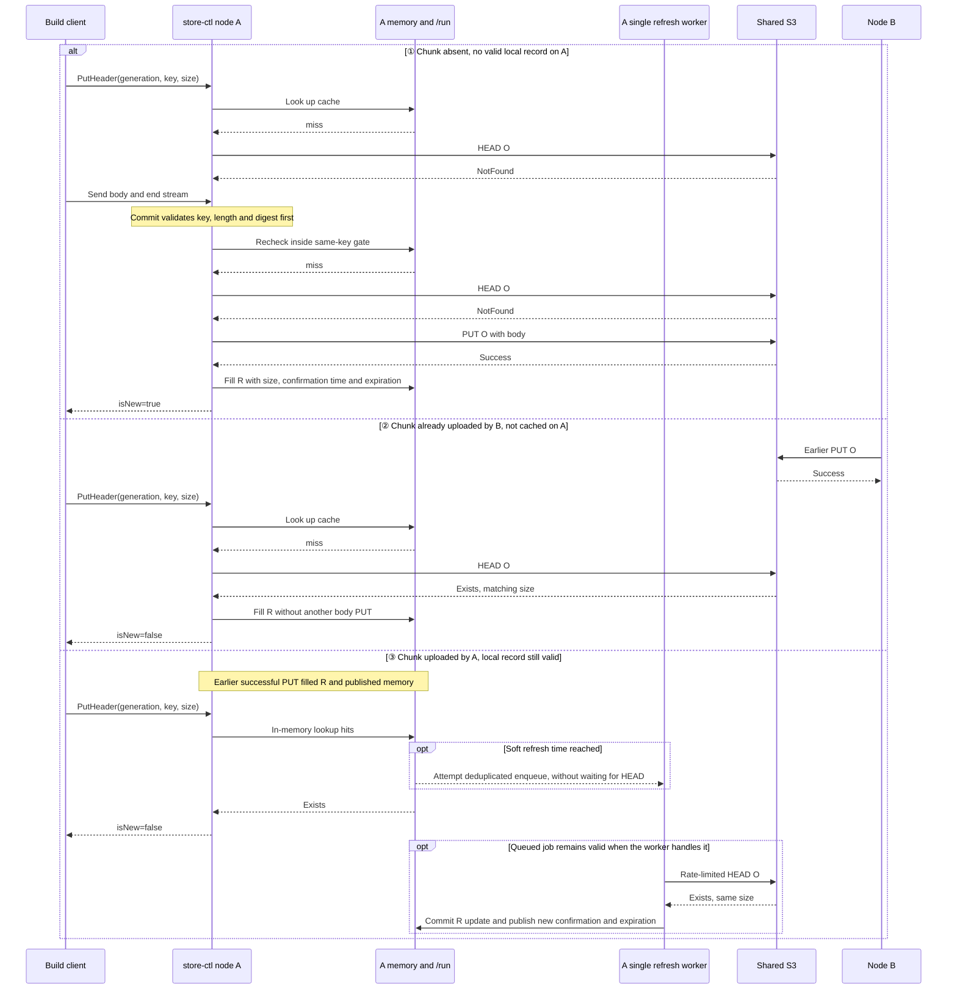
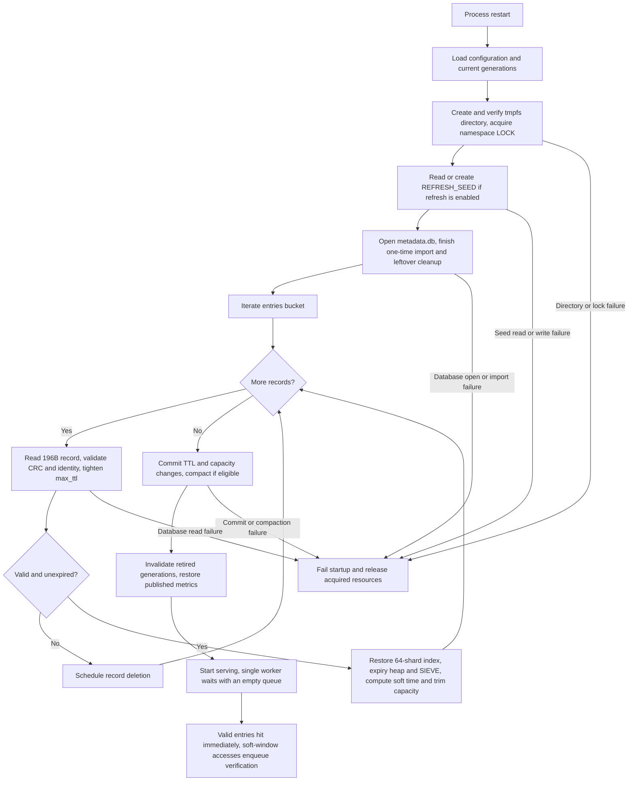

[English](store-chunk-metadata-cache-design.md) | [简体中文](store-chunk-metadata-cache-design_zh.md)

# store-ctl chunk_metadata_cache design

Updated: 2026-11-14. Based on v0.1.9, branch feat/store-chunk-metadata-cache.
Lookups use an in-memory map; recovery records reside in bbolt v1.4.3 on tmpfs. Validation results are included below. Not deployed to Nova.

## 1. Configuration and scope

The cache stores chunk existence and size only. It stores no bodies, excludes manifest/blob, and does not reduce GET requests.
It is enabled by default with a limit of 150000 entries. Hits use only the process-local map, with a 64-shard index and SIEVE eviction.
bbolt stores recovery metadata; normal hits do not query the database.

```yaml
s3:
  op_timeout: 10s
  chunk_metadata_cache:
    enabled: true
    dir: /run/store-ctl/chunk-metadata-cache
    max_entries: 150000
    max_ttl: 168h
    refresh_ahead:
      enabled: true
      max_qps: 2
stats_file: /run/store-ctl/chunk-metadata-cache-stats.json
stats_file_interval: 5s
```

Only relevant settings are shown; retain the existing S3 connection configuration. Explicit configuration overrides defaults.
Capacity, lifetime, the enabled refresh rate, and op_timeout must be positive.
The background uses exactly **1 worker**, with no refresh concurrency setting. Configuration changes require a restart; SIGHUP only refreshes generations.

`chunk_metadata_cache.enabled: false` disables caching and restores the original HEAD/PUT path, without refresh or same-key gates.
`refresh_ahead.enabled: false` disables early verification only; the cache still observes its hard expiration.
`stats_file: ""` independently disables the metrics file. Disabling caching does not automatically clear cumulative statistics.

## 2. Lifetime and access-triggered refresh

```text
Hard expiration after a new confirmation = successful HEAD/PUT confirmation time + max_ttl
Hard expiration on reload = min(original record expiration, confirmation time + current max_ttl)
Soft refresh time = confirmation time + actual record lifetime × random fraction [75%, 87.5%]
```

The default hard limit is **7 days**, with soft refresh scheduled **126–147 hours** after confirmation.
Access here means an existence-cache lookup triggered by Put/Commit. Body Get requests read S3 directly and do not access this metadata cache.

| Entry state at access | Behavior |
|---|---|
| Before soft refresh time | Return a cache hit without HEAD |
| At or after soft refresh time, before hard expiration | Return the cached result immediately and attempt to queue verification |
| Hard-expired | Reject the old cached presence, perform foreground HEAD, and cache a new confirmation |

**No access means no proactive verification. No periodic full-cache scan issues S3 HEAD requests.**
Each entry has at most one queued or in-flight job. The single worker processes jobs sequentially, starting at most 2 SDK HEAD calls per second by default.
The queue is bounded by max_entries. A full queue still allows valid cache hits; later accesses may retry enqueueing.
Rate limits, queueing, and refresh failures never extend expiration, so a batch of chunks first reused after 7 days can still cause a burst of origin requests.

| Background verification result | Handling |
|---|---|
| Exists, same size, current version | Persist the new confirmation and expiration before publishing to memory; preserve SIEVE position and the visited flag |
| NotFound or size changed | Delete the local record and invalidate cached presence; do not create a negative cache entry |
| Timeout, 403, 5xx, or other error | Keep the original expiration; back off with jitter and retry on a later access, without extending the hard limit |
| Entry or generation invalidated, or a newer version exists | Discard the stale result; do not refill or overwrite the newer record |

Background calls are bounded by op_timeout and the original hard expiration, and use the same-key gate and global S3 semaphore.
The random refresh point derives from a persisted seed, object ID, and confirmation time; restart does not resample it.
Graceful shutdown cancels and joins the worker before publishing final metrics.

## 3. Cache identity, concurrency, and recovery

- Keys bind storage identity, generation, and the 32-byte ContentKey. Storage identity includes endpoint, region, bucket, prefix, and path_style; the index uses SHA256.
- Fill after HEAD confirms existence with a matching size, or after a successful PUT. Errors, NotFound, and Abort do not fill the cache. Commit still validates the key, length, and digest first.
- Hot hits do not wait for an object gate or file I/O. Misses recheck inside the gate. Gate wait, S3 semaphore wait, HEAD, and an optional PUT share the original stage timeout budget.
- Capacity includes pending deletions. Cleanup and SIEVE scanning each have a budget of 128 entries per batch. Exhausting a budget skips the fill without changing a successful S3 result.
- Each namespace has one metadata.db. Its entries bucket uses a 32 B object ID as the key and a 196 B checksummed record as the value; the meta bucket stores format and storage identity.
- bbolt is pinned to v1.4.3, with NoSync=true and NoGrowSync=true by default. Commits and growth do not explicitly fsync; database file-lock acquisition waits at most 1 second.
- Transaction commit still waits for write system calls to complete. Fills and refreshes commit before publishing to memory. There is no additional periodic Sync or flushing thread. A machine reboot loses tmpfs itself.
- v1.4.3 still performs one internal initialization fdatasync when creating a database, including a compaction destination. NoSync disables subsequent transaction syncing; the third-party library source is unchanged.
- Background NotFound/size-change handling commits deletion before invalidating cached presence. Administration completes cache deletion before deleting remote objects. Failure enters bypass.
- Reload validates identity, CRC, size, and expiration, and copies record fields into the process heap. No mmap slices survive their transaction.
- Restart restores only remaining lifetime. Reducing max_ttl tightens and persists expiration; increasing the setting or restarting never renews old records.
- Retiring a generation invalidates its entries; epochs prevent in-flight requests from refilling them. A direct DropGeneration also prevents that generation from being cached again during the current Store lifetime.
- Offline purge --all clears the local cache and holds its lock before deleting remote objects. Other hosts' replicas require deployment-wide handling.
- Cache database/file I/O failure enters bypass until restart; successful remote operations still return success. Startup reload I/O failure prevents startup.

Directories are created automatically and checked for a real tmpfs filesystem. Only one writer may own a namespace.
Non-root processes need directory permissions, and the service manager must preserve the runtime directory.
Process restart can recover the cache; machine reboot, unmount, or clearing the directory causes a cold start.
Cache mutations use short write transactions; no S3 request runs inside a transaction.

## 4. /run directory layout

### 4.1 File roles

The default layout contains metadata and metrics, with no chunk bodies:

```text
/run/store-ctl/
├── chunk-metadata-cache-stats.json        # Metrics snapshot readable with cat
├── chunk-metadata-cache-stats.json.lock   # Exclusive metrics-writer lock
└── chunk-metadata-cache/
    └── <namespace>/                      # SHA256 of storage identity
        ├── LOCK                          # Exclusive process lock for this namespace
        ├── REFRESH_SEED                  # 32-byte refresh seed
        └── metadata.db                  # bbolt: entries and meta buckets
```

- Namespaces isolate endpoint, region, bucket, prefix, and path_style; object-id additionally binds generation and ContentKey.
- REFRESH_SEED is created/read when early verification is enabled and reused after restart, preserving soft refresh schedules.
- With default early verification and metrics enabled and one namespace, steady state has 5 regular files. Directories, temporary files, and historical namespaces are additional.
- Metrics and the seed still use same-directory temporary files plus rename. Cache records use database transactions. The LOCK inode is never deleted or replaced.
- metadata.db.compact appears temporarily during startup compaction. Holding the namespace LOCK allows cleanup of a previous interrupted compaction file.
- Graceful exit and SIGKILL preserve committed records. Unfinished transactions are not recovered as committed updates.
- First startup imports existing valid records once. An individual record that cannot be opened/read is skipped, logged, and counted in errors_total without blocking other records' recovery.
- The original record directory is deleted only after the import-completion marker commits. Interrupted import can retry; completed import never reimports leftovers. Directory traversal, database commit, or source-directory cleanup errors still prevent startup.
- Disabling caching does not delete its directory; the independent metrics file may continue updating. Offline purge --all clears the database and migration leftovers without clearing metrics history.
- `dir` and `stats_file` are independently configurable, but both must reside on real tmpfs. The program creates directories, not mounts. Non-root access requires permissions, and the service manager must preserve the runtime directory. Machine reboot loses these files.

### 4.2 Three submission sequences

These typical cases assume no concurrent changes, identical storage/generation/ContentKey, matching size, and successful cache fills. Path shorthand:

```text
K = hexadecimal ContentKey; I = local composite object ID in hexadecimal
O = S3 object key: <prefix>/chunk/<generation>/<first 2 hex digits of K>/<next 2 hex digits of K>/<K>
R = node A's record: /run/store-ctl/chunk-metadata-cache/<namespace>/metadata.db, entries[I]
```

Nodes A and B share S3, but their /run directories and memory are independent; their caches do not synchronize automatically.
In the diagram, filling R means committing a database transaction before publishing to memory. Normal lookups read only memory.



| Case | Foreground HEAD | PUT | Local result |
|---|---:|---:|---|
| ① Absent | 2 | 1 | Successful PUT creates R and its in-memory entry |
| ② Uploaded by another node, local miss | 1 | 0 | Successful HEAD creates R and its in-memory entry |
| ③ Uploaded by this node, valid local hit | 0 | 0 | Keep the record; asynchronous HEAD in the soft window is counted separately |

The uploading node is not part of the key. After case ② establishes a local entry, it can also hit without foreground HEAD.
An evicted, expired, or lost record in case ③ requires HEAD again.
The two HEAD calls in case ① are the header check and final Commit check. NotFound is not cached. Cross-node concurrency does not guarantee a single PUT per key.

### 4.3 Process restart and cache reconstruction

With caching enabled by default, startup rebuilds from local records without bulk S3 LIST or HEAD:



- After graceful exit or SIGKILL, committed R records can reload with their remaining lifetime; startup does not add another 7 days.
- Records rebuild the in-memory index, expiry heap, and SIEVE. Old process pointers and historical access order are not restored.
- The refresh queue is not persisted and restarts empty. Uncommitted refreshes do not extend expiration; a later access may enqueue again.
- A missing database or no valid records produces an empty cache, filled by subsequent foreground HEAD/PUT confirmations rather than full S3 prewarming.
- A machine reboot loses tmpfs and starts cold. Loss of the metrics file also starts a new counter chain.

## 5. Essential diagnostic metrics

Read with `cat /run/store-ctl/chunk-metadata-cache-stats.json`; the default publication interval is 5 seconds.
Use updated_at and service_state to check that publication continues. Cache state is active, bypass, disabled, or closed.

| Key field | Meaning |
|---|---|
| `chunk.put_requests_total` | Submissions passing header validation, including repeated keys, later failures, and in-flight requests. Not a count of unique chunks. |
| `chunk.dedup_rate_percent` | Total deduplication rate: deduplicated submissions / submissions × 100. |
| `chunk.cache_intercept_rate_percent` | Cache interception rate: submissions deduplicated by cache / submissions × 100. |
| `chunk.s3_head_calls_total` | Actual foreground and background SDK HEAD calls, including failures. |
| `chunk.s3_put_calls_total` | Actual SDK PUT calls, including failures. |
| `chunk_metadata_cache.entries` | Tracked entries plus pending deletions, including expired records not yet cleaned up. Not the total number of S3 chunks. |
| `chunk_metadata_cache.refresh_queue_entries` | Jobs waiting for the single worker, excluding its one active job. |
| `chunk_metadata_cache.errors_total` | Cache database/file I/O errors or background verification errors. Logs provide details; normal NotFound is not a service error. |
| `chunk_metadata_cache.fills_dropped_total` | Cache fills skipped because cleanup is backlogged or the SIEVE scan budget is exhausted. Not S3 upload failures or refresh enqueue failures. |

Cumulative deduplication and interception counters are restored and used to recompute percentages.
Background verification does not increment submission or deduplication counts.
Percentages have at most two decimal places; a zero denominator produces null. SDK call counts exclude individual internal HTTP retries and are not billing request counts.
Counters recover the published portion of the same counter_epoch; instance state and queue depth are recomputed. Abnormal exit may lose unpublished increments.
Use counter deltas from the same statistical chain for interval measurements, rather than dividing cumulative counters by a reset uptime.
Metrics-write failure preserves the last complete snapshot.

## 6. Performance considerations

The goal is fewer S3 HEAD and duplicate PUT requests with inexpensive normal cache hits.

| Design | Benefit and cost |
|---|---|
| Keep size, expiration, and identity in memory | Hits avoid bbolt queries, tmpfs reads, and CRC checks; recovery rebuilds from the database. Both the process heap index and tmpfs data consume memory. |
| 64-shard read locks and SIEVE | Hits set a visited flag without moving a global LRU list entry. This reduces contention across keys but is not fully lock-free. |
| Hot hits skip object gates and timeout timers | Lookup and gate handling within a stage reuse the object ID, reducing hashing, locks, and allocations. Only misses enter gates; body reception holds no gate. |
| Gate-protected recheck and a shared timeout budget | Reduce duplicate PUTs on the same node. Waiting does not restart the timeout, preventing cumulative timeout chains. There is no atomic cross-node deduplication. |
| Access-triggered verification, one worker, bounded queue | Unaccessed entries generate no verification HEAD. Foreground hits do not wait for refresh. Background rate and request latency determine throughput; queueing cannot extend hard expiration. |
| Single bbolt file and short write transactions | Remove per-record inode and page overhead. Mutations remain single-writer, while hot hits avoid database transaction waits. S3 calls hold no write transaction. |
| Cleanup and eviction batches capped at 128 entries | Avoid large maintenance work during one foreground fill. If the budget is insufficient, skip the fill; later requests may access the origin again. |
| Few counters and JSON publication every 5 seconds | Avoid multiple global counter updates for every internal lookup while retaining submission rates, S3 calls, and diagnostic state. Abnormal exit may lose unpublished increments. |

Index lookup for a normally valid hit is O(1) on average; expiry-heap maintenance is O(log N).
Cold lookups, refresh, and reload also depend on queueing, file I/O, and S3 latency.
`max_entries` bounds records in the current namespace, including pending deletions; it is neither a database byte limit nor a limit for all of /run.
At 32 B per key and 196 B per value, 150000 raw KV pairs occupy about 32.6 MiB, before B+Tree pages, free pages, the Go index, and in-flight buffers.
The database mmap and tmpfs file data share backing pages; do not count them as two complete copies. The process heap index is additional.
Startup iterates the database sequentially. Local reload measured about 0.31–0.41 seconds for 150000 entries and 0.42–0.54 seconds for 200000 entries; measurement conditions are below.

bbolt reuses freed pages but does not shrink its file automatically. After reload cleans expired/corrupt records and trims capacity,
a database of at least 16 MiB with at least half its logical pages reclaimable is copied into metadata.db.compact, closed, atomically replaced, and reopened.
Compaction precedes serving requests and needs temporary extra space. The namespace LOCK protects replacement; interruption before or after replacement leaves a valid database.
There is no additional runtime compaction thread or long-lived read transaction.

If 150000 entries queue together, the ideal processing time at 2 calls per second is about 20.8 hours.
HEAD latency, backoff, and downtime further constrain a single worker.
Early verification can reduce synchronized origin traffic but cannot guarantee verification of every record before hard expiration; inspect the queue, S3 calls, and errors together.

## 7. Validation and limits

bbolt is pinned to v1.4.3. Store, App, and CLI regression tests, race checks, and vet passed.
Coverage includes transaction rollback/exit inside a transaction, SIGKILL during continuous NoSync writes, reload capacity trimming and TTL tightening,
CRC/identity validation, invalidation surviving restart after refresh NotFound/size changes, batched legacy import, skipping individual unreadable records,
interrupted-import retry, preventing reimport after completion, startup compaction, and offline purge.

All 9 real MinIO E2E scenarios passed:

| Scenario | HEAD / PUT |
|---|---|
| Cache disabled, 100 submissions of the same chunk | 101 / 1 |
| Default caching enabled, 100 submissions of the same chunk | 2 / 1 |
| 100 more submissions after SIGKILL and restart | 0 / 0 |
| Single-worker queued refresh for 3 chunks, then SIGKILL, restart, and resubmit | After restart: 0 / 0 |

Validation includes complete GET body checks, successful S3 PUT despite database EFBIG and cache bypass, hard-expiration fallback,
and the shared timeout budget under stalled HEAD calls.
strace of database creation and 2000 fills found only 1 initialization fdatasync; reload issued 0 fsync/fdatasync calls.

The 150000/200000-entry measurements enable early verification and query each entry once in a random order with seed=42.
Each group uses 3 fresh processes; tables show medians. Hardware: Intel Xeon Gold 6266C, 88 logical CPUs, 4 KiB pages.
GOMAXPROCS equals the worker count; CPU affinity is not pinned.
Reload timing is not full service readiness. Query timing excludes reload, pre-generated ContentKeys/permutations, and RPC; its window contains no S3 calls.

| Entries | tmpfs file data | Live process heap increase | Files per namespace |
|---|---:|---:|---:|
| 150000 | 53.1 MiB | About 60.0 MiB | 3 |
| 200000 | 70.4 MiB | About 72.2 MiB | 3 |

File data includes the database and refresh seed; LOCK has no data pages. Directories/inodes, the Go runtime, and in-flight bodies are additional.
Including the independent metrics JSON and lock, the default single-namespace layout contains 5 regular files. Heap increase is not total process RSS.

| Entries/queries | Workers | Query wall time ms | Query CPU ms | p99 µs | Local reload ms |
|---|---:|---:|---:|---:|---:|
| 150000 | 1 | 207.8 | 207.2 | 4.80 | 414.7 |
| 150000 | 32 | 13.2 | 330.2 | 5.92 | 313.1 |
| 200000 | 1 | 279.1 | 278.3 | 4.83 | 542.0 |
| 200000 | 32 | 16.8 | 443.5 | 6.14 | 416.1 |

These results do not represent refresh peaks, eviction at capacity, or mixed upload throughput.
Database compaction runs only at eligible startup stages and does not provide a strict byte limit.
External deletion may invalidate cached existence before its deadline; the cache cannot restore deleted bodies.
Disable caching if every submission must verify remote presence. Nova deployment and VM E2E were not performed.

## 8. Upgrade and operations

Check these five items before deployment:

1. **Set s3.op_timeout explicitly.** An empty value in baseline cf7353c adds no per-call timeout. With caching enabled by default on this branch, an empty value becomes 10s.
   This affects data-backend Get/HEAD/PUT, including manifest/blob, and Delete, not only chunk operations. LIST has a separate budget of at least 60s; the generation source has its own settings.
   Slow-link large-object reads may newly time out. Choose a positive value for object sizes and link latency; this is not an overall RPC deadline.
2. **Check /run capacity:** inspect df -h /run and df -i /run. File data for 150000 entries measured about 53.1 MiB, with additional needs for the process heap, a compaction copy, and migration source files. Historical namespaces also consume capacity.
3. **Verify the actual nova-2 baseline:** this branch starts from cf7353c. Compare the running binary version and local patches before replacement; the v0.1.9 label alone does not prove identical code.
4. **Update service directory preparation together with the binary:** the supplied service uses the recommended RuntimeDirectory=store-ctl, RuntimeDirectoryPreserve=yes, and matching service user.
   The hard requirement is real tmpfs and permission to create/write the cache directory. Precreating it with the correct owner also works. An old non-root unit without directory preparation may restart-loop. Containers whose /run is an ordinary filesystem need a tmpfs mount.
5. **stats_file must also reside on tmpfs,** including explicitly enabled metrics for an FS backend. Disabling caching alone does not disable the S3 default metrics file. To avoid local tmpfs files, also set stats_file: "".

`purge --all` requires stopping all related serve processes and writers. Run `purge --generation` during a quiescent period after draining in-flight reads/writes, or stop the related serve processes and writers first.
The CLI uses an uncached admin Store and does not directly notify running serve processes; serve invalidates that generation's cache only on the next successful generation-list publication.
File/S3 generation sources refresh every 5 seconds by default. SIGHUP can trigger refresh, but is not a cross-process invalidation or in-flight-request drain barrier.
There is no fixed upper bound of "refresh interval + deletion duration": refresh failure retains the old list, and already admitted requests may continue.

Reload checks confirmation times against the local wall clock. Records confirmed in the future are deleted persistently, potentially causing a batch of cold-cache misses after a large clock rollback or VM snapshot restoration.
Not every entry necessarily disappears, and this cleanup does not affect S3 bodies. Running lifetime checks retain monotonic time; a clock rollback alone does not immediately trigger a full reload.

Background refresh HEAD holds the same-key gate. Foreground cache hits that are valid and size-matching return without waiting for the gate.
Only foreground misses, such as eviction, size mismatch, or expiration, may queue and exhaust op_timeout, including wait time, during S3 degradation.
Callers handle such failures under their own retry policy. The cache neither extends hard expiration nor adds implicit business-operation retries.
