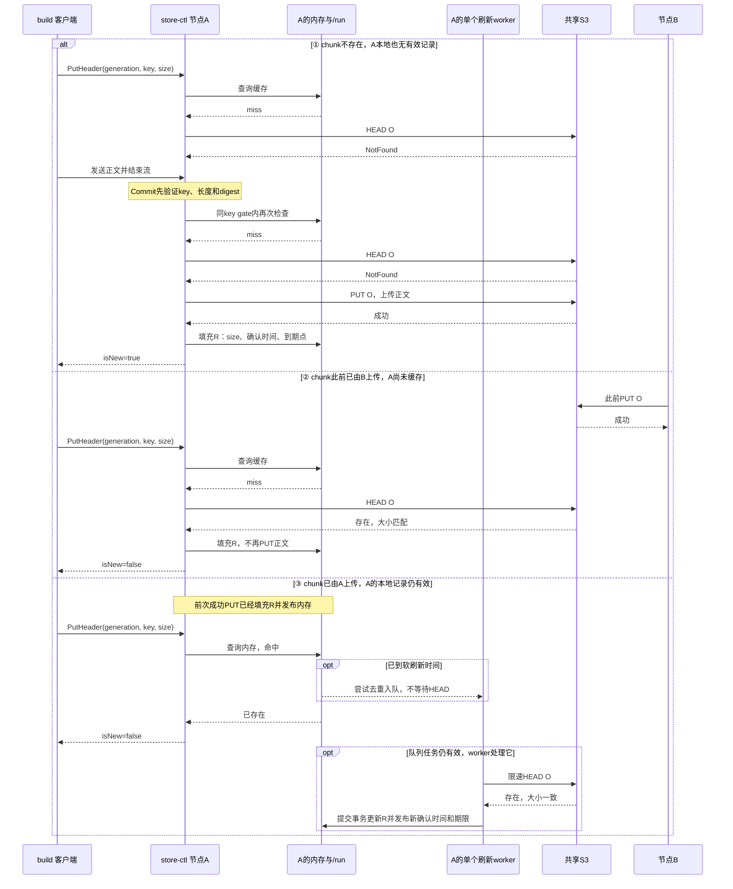
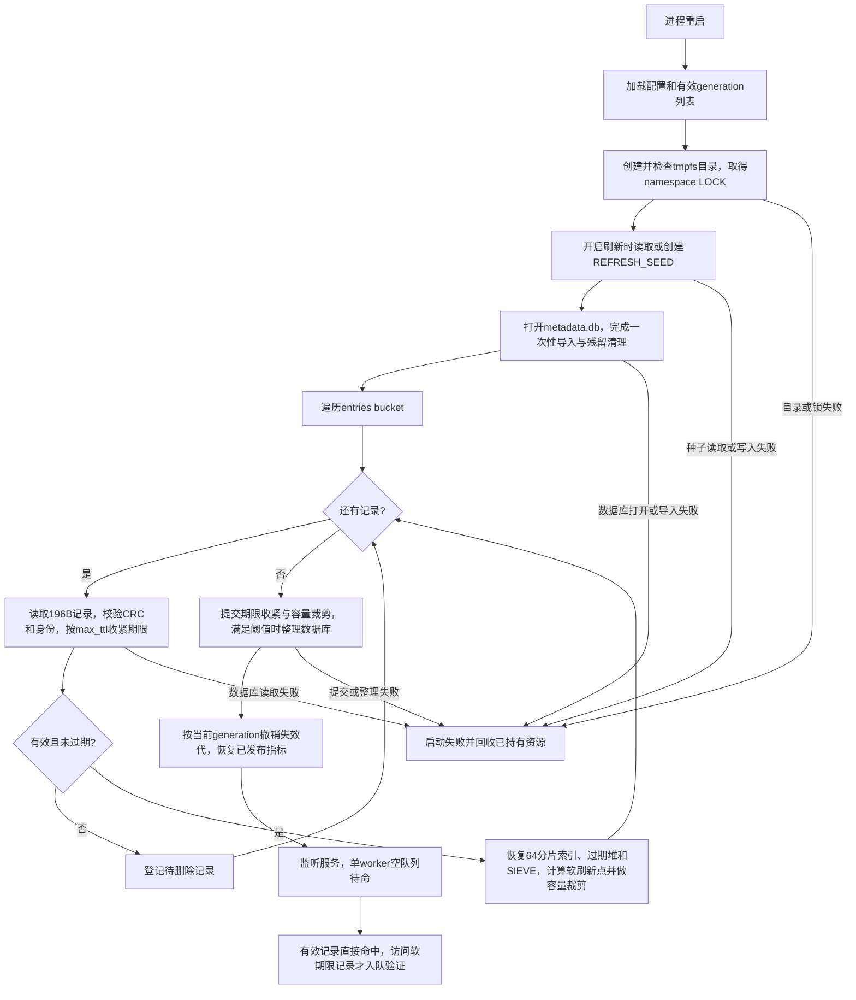

[English](store-chunk-metadata-cache-design.md) | [简体中文](store-chunk-metadata-cache-design_zh.md)

# store-ctl chunk_metadata_cache 设计说明

更新：2026-11-14。基于 v0.1.9，分支 feat/store-chunk-metadata-cache。
查询使用内存 map，恢复记录保存于 tmpfs 上的 bbolt v1.4.3；本次替换的验证结果见末节。未部署 Nova。

## 1. 配置与作用

只缓存 chunk 的存在性和大小，不保存正文，不处理 manifest/blob，不减少 GET。
默认开启，最多 150000 条；命中只查进程内存 map，使用 64 分片索引和 SIEVE 淘汰。
bbolt 只保存恢复所需的元信息，正常命中不查询数据库。

```yaml
s3:
  op_timeout: 10s
  chunk_metadata_cache:
    enabled: true
    dir: /run/store-ctl/chunk-metadata-cache
    max_entries: 150000
    max_ttl: 168h
    refresh_ahead:
      enabled: true
      max_qps: 2
stats_file: /run/store-ctl/chunk-metadata-cache-stats.json
stats_file_interval: 5s
```

只展示相关配置，原有 S3 连接配置继续保留。配置覆盖默认值；容量、期限、启用时的速率与 op_timeout 必须大于零。
后台固定 **1 个 worker**，不提供刷新并发数配置。配置变更需重启，SIGHUP 只更新 generation。

`chunk_metadata_cache.enabled: false` 关闭缓存，恢复原 HEAD/PUT 路径，不启动刷新、不使用同 key gate。
`refresh_ahead.enabled: false` 只关闭提前验证，缓存仍按硬期限使用。
`stats_file: ""` 单独关闭指标文件；关闭缓存不会自动清空累计统计。

## 2. 有效期与访问触发刷新

```text
新确认的硬过期时间 = 成功 HEAD/PUT 确认时间 + max_ttl
重载硬过期时间 = min(原记录期限, 确认时间 + 当前 max_ttl)
软刷新时间 = 确认时间 + 该记录实际有效期 × 随机比例 [75%, 87.5%]
```

默认硬上限 **7 天**，软刷新时间分布在确认后的 **126～147 小时**。
这里的访问指 Put/Commit 触发的存在性缓存查询；正文 Get 直接读 S3，不触发这份元数据缓存。

| 访问时的条目状态 | 行为 |
|---|---|
| 未到软刷新时间 | 直接命中，不发 HEAD |
| 已到软刷新时间、尚未硬过期 | 立即返回缓存结果，同时尝试入队验证 |
| 已硬过期 | 不使用旧 positive，前台同步 HEAD，确认后重新缓存 |

**不访问就不主动验证，不定时扫描全量条目向 S3 发 HEAD。**
同一条目同时最多一个排队或在途任务；单 worker 顺序处理，默认最多发起 2 次 SDK HEAD/秒。
队列按 max_entries 有界；队列满时继续返回有效缓存，后续访问可再次尝试入队。
限流、排队或刷新失败不能续期，因此超过 7 天才再次使用的一批 chunk 仍可能集中回源。

| 后台验证结果 | 处理 |
|---|---|
| 存在、大小一致且版本有效 | 先持久化新确认时间和期限，再发布内存；不改变 SIEVE 位置/访问标记 |
| NotFound 或大小变化 | 清除本地记录并撤销当前 positive，不建立 negative 缓存 |
| 超时、403、5xx 等错误 | 保留原期限，退避并抖动；后续访问再尝试，不能超过硬上限 |
| 条目或 generation 已失效、已有新版本 | 丢弃旧结果，不回填、不覆盖新记录 |

后台调用受 op_timeout 和原硬过期点限制，使用同 key gate 和全局 S3 semaphore。
随机点由持久化种子、对象 ID、确认时间派生，重启不重新抽签。正常关停先取消并等待 worker，再发布最终指标。

## 3. 缓存身份、并发与恢复

- key 绑定存储身份、generation、32 字节 ContentKey；存储身份含 endpoint、region、bucket、prefix、path_style，实际索引使用 SHA256。
- HEAD 确认存在且大小匹配、或 PUT 成功后填充。错误、NotFound、Abort 不填充；Commit 仍先校验 key、长度和 digest。
- 热命中不等待对象 gate 或文件 I/O；miss 在 gate 内二次检查。gate、S3 排队、HEAD 与可选 PUT 共用原阶段超时预算。
- 容量包含 pending 删除项；清理与 SIEVE 扫描各有单批 128 项预算，预算不足跳过填充，不影响已成功的 S3 操作。
- 每个 namespace 一个 metadata.db，entries bucket 使用 32 B 对象 ID 作 key、196 B 校验记录作 value；meta bucket 保存格式与存储身份。
- bbolt 固定 v1.4.3，默认 NoSync=true、NoGrowSync=true，提交和扩容不主动 fsync；打开文件锁最多等待 1 秒。
- 事务提交仍等待写系统调用完成，填充/刷新先提交事务再发布内存；不额外创建定时 Sync 或刷盘线程。机器重启后 tmpfs 本身丢失。
- v1.4.3 新建数据库时仍有一次库内部的初始化 fdatasync，包括创建整理目标库；NoSync 关闭的是后续事务同步，不修改第三方库源码。
- 后台 NotFound/大小变化先提交持久化删除再撤销 positive；管理操作在删除远端前完成缓存删除。失败进入 bypass。
- 重载校验身份、CRC、大小与期限，并复制记录内容到进程堆内存；不保留事务结束后的 mmap 切片。
- 重启按剩余期限恢复；缩短 max_ttl 会收紧并持久化，扩大配置或重启不会给旧记录续期。
- generation 退役撤销记录，epoch 阻止在途请求回填；直接 DropGeneration 后，该 generation 在当前 Store 生命周期内禁止缓存。
- 离线 purge --all 先清本机缓存并持锁，再删除远端。其他主机副本需按部署范围处理。
- 缓存数据库/文件 I/O 故障进入 bypass 至重启；远端成功仍返回成功。启动重载 I/O 失败则启动失败。

自动创建目录并检查真实 tmpfs，同 namespace 只允许一个写者。非 root 需目录权限，服务管理器需保留 runtime 目录。
进程重启可恢复；机器重启、卸载或清目录会冷启动。缓存修改使用短写事务，S3 请求不在事务内执行。

## 4. /run 目录布局

### 4.1 文件用途

默认布局如下，只有元数据和指标，不包含 chunk 正文：

```text
/run/store-ctl/
├── chunk-metadata-cache-stats.json        # 可直接 cat 的指标快照
├── chunk-metadata-cache-stats.json.lock   # 指标文件的独占写者锁
└── chunk-metadata-cache/
    └── <namespace>/                      # 存储身份的 SHA256
        ├── LOCK                          # 本 namespace 的进程独占锁
        ├── REFRESH_SEED                  # 32 字节刷新随机种子
        └── metadata.db                  # bbolt：entries + meta 两个 bucket
```

- namespace 隔离不同 endpoint、region、bucket、prefix、path_style；object-id 进一步绑定 generation 和 ContentKey。
- REFRESH_SEED 在开启提前验证时创建/读取，重启复用，避免每次启动重新分配软刷新时间。
- 默认开启提前验证、指标且只有一个 namespace 时，稳态共 5 个普通文件；目录、临时文件和历史 namespace 另计。
- 指标和种子继续通过同目录临时文件加 rename 发布；缓存记录通过数据库事务发布。LOCK 的 inode 不删除或替换。
- metadata.db.compact 只在启动整理时临时出现；持 namespace LOCK 后清理上次中断的整理文件。
- 正常退出和 SIGKILL 保留已提交记录；未完成事务不作为已提交更新恢复。
- 首次启动一次性导入已有有效记录；单条记录打开/读取失败时跳过、记录日志并增加 errors_total，不阻止其他记录恢复。
- 导入完成标记提交后才删除原记录目录。中断可重试，完成后不再导入残留；目录遍历、数据库提交或源目录清理失败仍拒绝启动。
- 关闭缓存不会删除缓存目录，独立的指标文件仍可继续更新。离线 purge --all 清理数据库与迁移残留，不清除指标历史。
- `dir` 与 `stats_file` 可以分别配置，但都需位于真实 tmpfs。程序自动创建目录，不负责挂载；非 root 需权限，服务管理器需保留 runtime 目录。机器重启后这些数据会丢失。

### 4.2 三种提交场景时序

下图为无并发变化时的典型流程，假设同一存储位置、generation 和 ContentKey，大小匹配且缓存填充成功。路径简记如下：

```text
K = ContentKey 的十六进制；I = 本地组合对象 ID 的十六进制
O = S3 对象键：<prefix>/chunk/<generation>/<K前2位>/<K第3～4位>/<K>
R = 节点A记录：/run/store-ctl/chunk-metadata-cache/<namespace>/metadata.db，entries[I]
```

节点 A、B 共用 S3，但各自的 `/run` 和内存独立，不自动同步缓存。
图中的“填充 R”表示提交数据库事务后发布内存，普通查询只读内存。



| 场景 | 前台 HEAD | PUT | 本地结果 |
|---|---:|---:|---|
| ① 不存在 | 2 | 1 | PUT 成功后建立 R 与内存记录 |
| ② 其他节点已上传，本地 miss | 1 | 0 | HEAD 成功后建立 R 与内存记录 |
| ③ 当前节点已上传，本地有效命中 | 0 | 0 | 保留记录；软期限内的异步 HEAD 另计 |

上传节点不是 key 的一部分。② 建立本地缓存后也能零前台 HEAD 命中；③ 的记录若被淘汰、过期或丢失，也需重新 HEAD。
① 的两次 HEAD 分别是头部检查和 Commit 最终检查，不缓存 NotFound。跨节点并发不保证同 key 只有一次 PUT。

### 4.3 进程重启与缓存重建

默认缓存开启时，启动从本地记录重建，不向 S3 批量 LIST 或 HEAD：



- 正常退出或 SIGKILL 后，已提交的 R 可重载；只恢复剩余期限，不从启动时间重新加 7 天。
- 内存索引、过期堆和 SIEVE 由记录重建，不恢复旧进程的指针或历史访问顺序。
- 刷新队列不持久化，重启从空队列开始；未成功持久化的刷新不会续期，后续访问可再入队。
- 数据库不存在或没有有效记录时空缓存启动，随后由前台 HEAD/PUT 逐条填充，不从 S3 全量预热。
- 机器重启使 tmpfs 丢失，相当于空缓存；指标文件也丢失时开始新的计数链。

## 5. 关键诊断指标

直接 `cat /run/store-ctl/chunk-metadata-cache-stats.json`，默认每 5 秒发布。
看 updated_at 和 service_state 判断是否持续更新；缓存 state 为 active、bypass、disabled 或 closed。

| 关键字段 | 用途 |
|---|---|
| `chunk.put_requests_total` | 通过头部校验的提交次数，含重复 key、后续失败及在途请求，不是唯一 chunk 数。 |
| `chunk.dedup_rate_percent` | 总去重率：去重请求 / 提交请求 × 100。 |
| `chunk.cache_intercept_rate_percent` | 缓存拦截率：缓存去重请求 / 提交请求 × 100。 |
| `chunk.s3_head_calls_total` | 前台和后台实际 SDK HEAD 调用总数，含失败。 |
| `chunk.s3_put_calls_total` | 实际 SDK PUT 调用总数，含失败。 |
| `chunk_metadata_cache.entries` | 缓存登记项加待删项，含尚未清理的过期记录，不是 S3 总块数。 |
| `chunk_metadata_cache.refresh_queue_entries` | 等待单 worker 处理的任务数，不含正在执行的一个任务。 |
| `chunk_metadata_cache.errors_total` | 缓存数据库/文件 I/O 或后台验证请求异常；具体原因记录日志，正常 NotFound 不计服务错误。 |
| `chunk_metadata_cache.fills_dropped_total` | 因清理积压或 SIEVE 扫描预算耗尽跳过的缓存填充数，不是 S3 上传失败或刷新入队失败。 |

去重和缓存拦截的累计计数用于恢复并重新计算百分比；后台验证不增加用户提交或去重次数。
百分比最多两位小数，零分母为 null。SDK 调用数不含内部每次 HTTP 重试，不等于账单请求数。
Counter 按同一 counter_epoch 恢复已发布部分，实例状态与队列重新计算；异常退出可能丢失未发布增量。
观察区间效果用同一统计链的 Counter 差值，不用重置的 uptime 计算累计 QPS。指标写失败保留最后完整快照。

## 6. 性能考虑

目标是减少 S3 HEAD 与重复 PUT，同时让正常缓存命中保持低开销。

| 设计 | 性能收益与代价 |
|---|---|
| 内存保存 size、有效期和身份 | 命中不查询 bbolt、不读 tmpfs、不做 CRC；恢复时才从数据库重建。进程堆索引与 tmpfs 数据都占用内存。 |
| 64 分片读锁 + SIEVE | 命中只设置访问标记，不修改全局 LRU 链表；降低不同 key 的锁竞争，但不是完全无锁。 |
| 热命中跳过对象 gate 与超时定时器 | 同阶段的查询和 gate 复用对象 ID；减少哈希、锁和分配。miss 才进入 gate，接收正文期间不持有 gate。 |
| gate 内二次检查 + 共用超时预算 | 减少同节点并发重复 PUT；排队后不重新计时，避免等待者形成累加超时链。不提供跨节点原子去重。 |
| 访问触发、单 worker、有界队列 | 未访问的条目不产生验证 HEAD；前台不等待刷新。后台速率和单请求时延决定消化速度，排队不能延长硬期限。 |
| bbolt 单文件与短写事务 | 消除每条记录一个 inode 和一页的开销；修改仍为单写者，热命中不等待数据库事务，S3 调用不占写事务。 |
| 清理和淘汰单批最多 128 项 | 避免一次前台填充处理大量维护任务；预算不足时放弃填充，后续请求可能再次回源。 |
| 少量计数 + 每 5 秒发布 JSON | 不再为每次内部 lookup 更新多组全局计数；保留请求、去重率、S3 调用和诊断状态。异常退出可能丢失未发布增量。 |

正常有效命中的索引查找平均 O(1)，过期堆维护为 O(log N)；冷查询、刷新和重载还受排队、文件 I/O 与 S3 时延影响。
`max_entries` 限制当前 namespace 的记录数，包含待删项，不是数据库字节上限或整个 /run 的上限。
按 32 B key + 196 B value 计算，15 万条原始 KV 约 32.6 MiB；实际还需 B+Tree 页面、空闲页、Go 索引和在途缓冲。
数据库页的 mmap 与 tmpfs 文件数据属于同一批后备页，不能把两者简单相加为两份；进程堆索引是额外一份。
启动恢复顺序遍历数据库；15 万条缓存本机重载约 0.31～0.41 秒，20 万条约 0.42～0.54 秒，具体测量条件见末节。

bbolt 删除记录后复用空闲页，不自动缩小文件。重载清理过期/损坏记录并完成容量裁剪后，数据库至少 16 MiB 且可回收页达到逻辑总页数一半时，
复制有效数据到 metadata.db.compact，关闭后原子替换并重新打开；整理期间不接收业务请求，需要额外临时空间。
持 namespace LOCK 完成替换，进程在替换前后中断都保留一份有效数据库。运行期间不新增整理线程或长读事务。

若 15 万条同时排队，按每秒 2 次计算，理想处理时间约 20.8 小时；单 worker 下还受 HEAD 时延、退避和服务停机影响。
因此提前验证只能缓解集中回源，不能保证全部记录都在硬过期前验证完成；诊断时同时看刷新队列、S3 调用与错误。

## 7. 验证与边界

bbolt 固定 v1.4.3；Store、App、CLI 回归、race 与 vet 通过。
覆盖事务回滚/事务内退出、持续 NoSync 写入中 SIGKILL、重载容量裁剪与期限收紧、CRC/身份校验、
刷新 NotFound/大小变化后重启不复活、旧记录分批导入/单条不可读跳过/中断重试/完成后不重导、启动整理和离线 purge。

真实 MinIO 的 9 个 E2E 场景通过：

| 场景 | HEAD / PUT |
|---|---|
| 缓存关闭，100 次同 chunk 提交 | 101 / 1 |
| 默认开启，100 次同 chunk 提交 | 2 / 1 |
| SIGKILL 重启后再提交 100 次 | 0 / 0 |
| 3 个 chunk 的单 worker 排队刷新，随后 SIGKILL 重启再次提交 | 重启后 0 / 0 |

验证包含完整 GET 正文、数据库写入 EFBIG 后旁路而 S3 PUT 仍成功、硬过期回源及停滞 HEAD 的共用超时预算。
strace 跟踪新建并填充 2000 条记录：只有 1 次初始化 fdatasync；重载时 0 次 fsync/fdatasync。

15 万/20 万条实测，开启提前验证，每条查询一次，随机顺序 seed=42；每组 3 个新进程，表中为中位数。
CPU 为 Intel Xeon Gold 6266C，88 逻辑核，4 KiB 页；GOMAXPROCS 等于 worker 数，未绑核。
重载计时不包含完整服务就绪；查询计时不含重载、预生成 ContentKey/排列和 RPC，查询窗口内无 S3 调用。

| 条目数 | tmpfs 文件数据 | 进程存活堆增量 | namespace 文件数 |
|---|---:|---:|---:|
| 150000 | 53.1 MiB | 约 60.0 MiB | 3 |
| 200000 | 70.4 MiB | 约 72.2 MiB | 3 |

文件数据包含数据库和刷新种子，LOCK 无数据页；另计目录/inode、Go 运行时与在途正文。
加上独立指标 JSON 和锁，单 namespace 的默认布局共 5 个普通文件；堆增量不是进程总 RSS。

| 条目/查询数 | worker | 查询墙钟 ms | 查询 CPU ms | p99 µs | 本地重载 ms |
|---|---:|---:|---:|---:|---:|
| 150000 | 1 | 207.8 | 207.2 | 4.80 | 414.7 |
| 150000 | 32 | 13.2 | 330.2 | 5.92 | 313.1 |
| 200000 | 1 | 279.1 | 278.3 | 4.83 | 542.0 |
| 200000 | 32 | 16.8 | 443.5 | 6.14 | 416.1 |

上述结果不代表刷新高峰、容量满时淘汰或混合上传吞吐。数据库整理只在满足阈值的启动阶段执行，不能承诺严格字节上限。
存在性缓存可能在有效期内遇到外部删除，不能恢复被删正文；要求每次提交都验证远端存在性时应关闭缓存。
未执行 Nova 部署或 VM E2E。

## 8. 升级与运维

部署前确认以下五项：

1. **显式设置 s3.op_timeout**。基线 cf7353c 的空值没有逐调用超时；本分支缓存默认开启后，空值补为 10s。
   此值作用于数据后端的 Get/HEAD/PUT（含 manifest/blob）及 Delete，不只作用于 chunk；LIST 使用独立的至少 60s 预算，generation 源另有配置。
   慢链路的大对象读取可能新增超时，按对象大小和链路时延设置正数；它不是整个 RPC 的总时限。
2. **核对 /run 容量**：检查 df -h /run 和 df -i /run。15 万条本机文件数据约 53.1 MiB，另需进程堆、整理临时副本和迁移源文件空间；历史 namespace 也占用容量。
3. **核对 nova-2 实际基线**：分支基于 cf7353c，替换前对比在役二进制版本及本地补丁，不能只按 v0.1.9 标签判断完全一致。
4. **同步更新服务目录准备方式**：推荐使用随代码提供的 RuntimeDirectory=store-ctl、RuntimeDirectoryPreserve=yes 和对应服务用户。
   硬要求是缓存目录真实位于 tmpfs 且进程可创建/写入；预创建并设置所有者也可。旧非 root 单元若没有目录准备，可能重启循环；容器的 /run 若为普通文件系统，需提供 tmpfs 挂载。
5. **stats_file 也必须位于 tmpfs**，包括 FS 后端显式开启指标文件时。仅关闭缓存不会关闭 S3 默认指标文件；不使用本地 tmpfs 文件时需同时配置 stats_file: ""。

`purge --all` 必须停止所有相关 serve 和写入者。`purge --generation` 应在业务静默并排空在途读写，或停止相关 serve 与写入者后执行。
CLI 使用无缓存的 admin Store，不会直接通知在运行的 serve；serve 要等下一次成功发布 generation 列表才撤销该代缓存。
文件/S3 generation 源默认每 5 秒刷新，SIGHUP 可触发刷新，但不构成跨进程失效或在途请求排空屏障。
窗口没有“刷新周期 + 删除耗时”的固定上界：刷新失败会保留旧列表，已接纳请求也可能继续执行。

重载按本机墙钟校验确认时间；确认时间落在当前时刻之后的记录会被删除并持久化，可能在大幅时钟回拨或 VM 快照恢复后形成集中冷缓存。
不是所有条目必然清空，S3 正文不受该清理影响。运行中的有效期判断保留单调时钟，不因一次回拨立刻触发全量重载。

后台刷新 HEAD 会持有同 key gate。前台有效且大小匹配的缓存命中直接返回，不等待 gate；
只有前台已经 miss（例如被淘汰、大小不匹配或过期）才可能排队，并在 S3 降级时耗尽包含等待时间的 op_timeout。
该类失败由调用方按其重试策略处理，不额外延长硬期限，也不在底层隐式重试业务请求。
